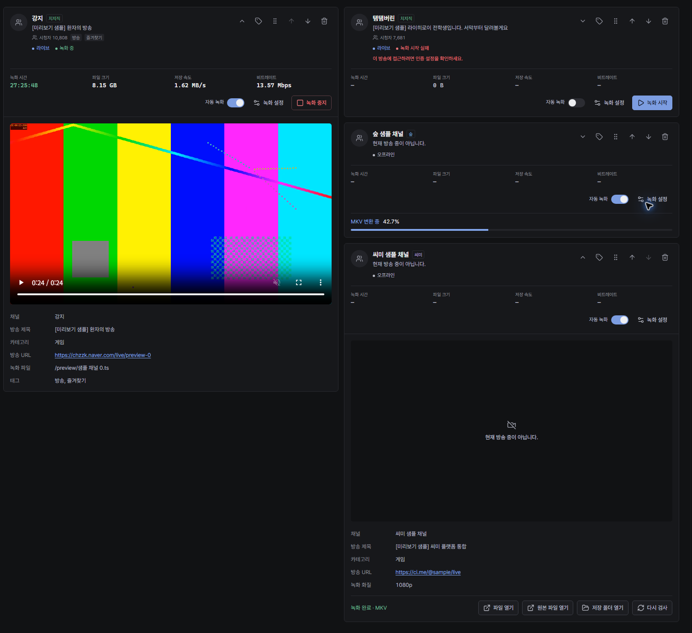
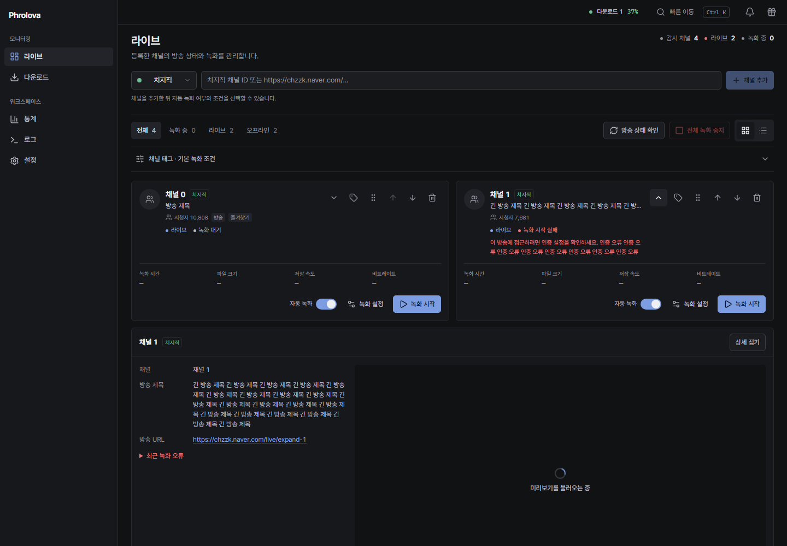
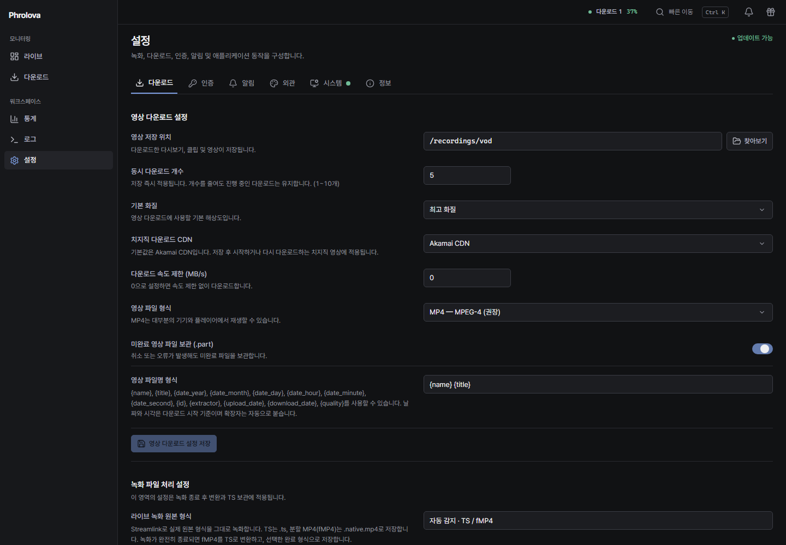

# 라이브·다운로드 UI 및 감시·후처리 검수 보고서

검수일: 2026-10-12. 기준: main `69de3d3` / v2.0.59. 수정 브랜치: `fix/live-ui-monitor-recovery`.

## 이번 수정의 결과

라이브 요약 카드는 채널 순서를 유지하는 2열 배치로 정렬된다. 카드의 확장 내용은 해당 요약 행 아래의 별도 상세 영역에 표시한다. 한 채널만 펼쳐도 다음 채널이 빈 열로 이동하지 않는다. 작은 화면과 목록 모드에서는 요약과 해당 상세 영역을 한 열로 표시한다. 재생·로딩·오류·오프라인 미리보기는 모두 16:9이며, 원본 4:3 영상은 `object-fit: contain`으로 표시한다.

치지직 라이브와 다운로드의 새 기본 CDN은 모두 Akamai이다. 선택 이름은 정확히 `Naver CDN`, `Akamai CDN`이다. 기존 저장값 `default`는 계속 Naver를 의미한다. 사용자가 명시적으로 저장한 선택값은 유지하며 데이터베이스·녹화 파일을 변경하는 마이그레이션은 없다.

## 실제 결함과 수정

| 문제 | 원인 | 실제 수정 파일 | 검증 및 결과 |
|---|---|---|---|
| 펼치면 숲·씨미가 다른 열로 이동하고 좌우 기준선이 달라짐 | 카드 전체 높이를 공유하는 subgrid와, 빈 열에 넣는 측정 기반 배치가 확장 높이를 요약 배치에 섞음 | `pages/Dashboard.tsx`, `components/dashboard/RecordingChannelCard.tsx`, `recording-channel.css`, `index.css` | 16가지 펼침 조합 × 3개 폭. 시각적 채널 순서·요약 시작점·지표·제어 버튼 좌표를 직접 검사: 통과 |
| 오류가 있는 카드와 정상 카드의 지표·버튼 높이가 달라짐 | 조건부 오류 문구와 시청자·태그 영역의 실제 높이를 각 카드가 따로 계산 | `hooks/useCardGrid.ts` | 행별 헤더의 실제 콘텐츠 크기만 공유. 전체 카드나 미리보기 고정 높이 없음. 긴 오류 및 후처리 상태 혼합 검사: 통과 |
| 오프라인 미리보기 크기가 재생 영역과 달라짐 | 상태별 축소 규칙 | `index.css`, `LivePreview.tsx` | 사용자가 선택한 16:9 표시를 모든 상태에 적용. 상태 그룹 중앙 정렬·가로 넘침 검사: 통과 |
| 보기 방식 전환에서 플레이어가 다시 연결됨 | 반응형 열 개수에 따라 DOM을 다시 이동하면 브라우저가 미디어 연결을 중단함 | `Dashboard.tsx` | 요약·상세의 React key와 DOM 구성을 유지하고 CSS로 표시 순서 전환. 동일 video와 resolver 호출 수 유지, 재생 프레임 증가 확인: 통과 |
| 상세의 접기 버튼을 누르면 포커스가 사라짐 | 포커스가 있는 상세 영역을 즉시 제거 | `Dashboard.tsx` | 해당 채널의 상세 버튼으로 포커스 복귀. 브라우저 포커스 검사: 통과 |
| 라이브·다운로드 입력 줄 높이와 상단 폭이 다름 | 다운로드 입력에 별도 Card 및 텍스트 영역 규칙, 상단 요약의 최소 콘텐츠 너비 | `DownloadInput.tsx`, `AddChannelForm.tsx`, `downloads.css`, `index.css`, `VodDownload.tsx` | 공통 입력 높이 34px, 모바일 44px. 320~2560px 주요 5개 화면 가로 넘침 0: 통과 |
| SSE 이후 오래된 GET이 새 상태를 덮음 | 초기 GET과 이벤트 스트림의 완료 순서 경쟁 | `hooks/useChannelStream.ts` | 최신 이벤트 이후 완료된 이전 응답은 무시. 취소·중복 GET·언마운트 정리. 재현 회귀 테스트: 통과 |
| 모든 플랫폼의 감시가 `composite_key` 오류로 중단됨 | ChannelTask에서 파생 키 속성 누락 | `backend/app/engine/channel.py`, `conductor.py` | 파생 키 추가, 기존 플랫폼+채널 식별 보존. 4개 플랫폼·재시작·삭제 중 느린 응답 검사: 통과 |
| 감시 오류가 녹화 실패/오프라인으로 표시되거나 녹화 재시도를 막음 | 감시·방송·녹화 상태와 오류가 하나의 필드에 섞임 | `conductor.py`, `client.ts`, `RecordingChannelCard.tsx`, `utils/channel.ts` | 감시 상태·현재 오류·최근 이력 별도 저장, 복구 시 현재 오류 해제. 기존 감시 오류 복구 테스트: 통과 |
| 검사에 성공해도 이전 후처리 오류가 남음 | 완료 상태의 진단 detail과 실패 단계가 남음 | `recording_finalizer.py`, `RecordingPostprocess.tsx` | 성공한 검사에서 이전 실패 detail/단계 해제. FFmpeg 경고는 실제 결과 검사를 통과한 뒤 별도 경고로 표시: 통과 |
| 경고가 있었던 원본이 삭제되거나 다시 변환 버튼이 없음 | 정상 종료 코드만으로 경고와 원본 보관 조건을 판단 | `recording_finalizer.py`, `RecordingPostprocess.tsx` | 경고 발생 시 원본 보존, 유효한 원본이 있으면 재변환 허용. 정상 결과·결과 검사 실패 모두 실제 FFmpeg로 검사: 통과 |
| 결과 파일과 원본 열기 버튼이 같은 파일을 엶 | 파일 API가 항상 결과 파일을 우선함 | `backend/app/api/recordings.py`, `client.ts`, `RecordingPostprocess.tsx` | 등록된 작업의 `source=true`로 원본 구별. 실제 FileResponse 바이트 검사, 없는 원본 404: 통과 |
| 처리 로그가 긴 JSON/이스케이프 문자열로 표시됨 | 중첩 진단을 그대로 JSON 출력 | `RecordingPostprocess.tsx` | 줄 단위 로그 표시, 160px 내부 스크롤, 긴 줄 줄바꿈, 로그 복사. Clipboard API 없는 HTTP 환경도 복구 경로 제공: 통과 |
| 만료 URL의 404가 인증 실패로 잘못 분류됨 | URL 포트 57403에 포함된 문자열 403을 HTTP 상태로 판단 | `recording_errors.py` | 실제 HTTP 응답/원인 체인 우선, URL 제외 후 독립 상태 코드 검사. 포트 401/403/5401/57403 및 실제 인증 오류 회귀: 통과 |
| 치지직 CDN 기본값과 표시 이름이 요청과 다름 | 설정·프런트엔드 fallback·API 요청 기본값이 Naver, 대안/권장 문구 혼재 | `core/config.py`, `api/vod.py`, `client.ts`, `VodContext.tsx`, `settings/DownloadTab.tsx`, `DownloadTaskHeader.tsx`, `DownloadTaskCard.tsx` | Akamai 기본값·정확한 옵션 이름·Naver 명시 선택·독립 저장·새로고침 복원·API 전달 검사: 통과 |

프런트엔드 경로는 `frontend/src/` 기준이다. Streamlink 라이브 녹화 및 yt-dlp 다운로드 구조, 녹화 완료 MKV 기본값, 기존 파일·설정·SQLite 데이터는 유지한다.

## 녹화 파일명 추가 수정

기존 `[32자리 세션 ID]`는 항상 녹화 파일명에 붙던 충돌 방지 식별자였다. 새 녹화는 `[채널] 제목 날짜.ts` 또는 실제 컨테이너의 `.native.mp4`로 저장하며 내부 세션 ID는 DB/작업 상태에만 사용한다. 파일명이 겹칠 때만 `(2)`, `(3)`을 붙인다. URL 확인이 끝난 뒤 `xb` 배타적 파일 생성으로 이름을 예약하므로 동시에 같은 제목을 시작해도 서로의 원본에 추가 쓰기하지 않는다. TS·fMP4·정규화 TS·MKV·MP4·썸네일·별도 오디오 파일을 충돌 검사에 포함한다. 후처리 충돌 시에도 짧은 번호를 사용한다.

관련 파일: `backend/app/engine/pipeline/ytdlp.py`, `recording_finalizer.py`, `backend/tests/test_recording_filenames.py`, `test_recording_defaults.py`.

## 화면 비교

수정 전: 사용자가 제공한 화면. 한쪽 카드의 펼침 높이가 다음 채널 배치를 바꾸고 큰 빈 열이 발생한다.

수정 후: 격리된 API로 긴 오류·녹화·오프라인·후처리 진행·완료 상태를 혼합해 실제 Chromium에서 캡처했다. 요약은 같은 행에 정렬되고 상세는 별도 전체 폭 영역이다.

실시간 개발 미리보기: `http://127.0.0.1:3001/`. 이 미리보기는 샘플 API와 FFmpeg로 생성한 HLS 영상을 사용한다. 실제 사용자의 녹화나 데이터베이스에 테스트 작업을 생성하지 않는다.

## 버튼 및 상태 검수

- 라이브: 개별·동시 상세 펼침/접기, 녹화 설정 저장, 자동 녹화 대기/실패/복원, 녹화 시작·중지, 채널 이동, 태그 추가·제거, 삭제 확인, 상태·태그 필터, 카드/목록 전환.
- 미리보기: 실제 HLS 16:9·4:3 디코딩, 재생 프레임 증가, 재시도, 오프라인, 크기 전환, 동일 video 보존, 접기/재열기 리소스 정리. CHZZK·YouTube·SOOP·CIME 공통 UI 경로 검사.
- 다운로드: 단일·다중 URL, 중복 검증, 플랫폼 입력, 품질 선택, 시작/전체 시작, 일시정지·재개, 재시도, 다시 검사, 파일 링크, 작업 상태·통계, 카드/목록 6개 폭.
- 후처리: 진행률, 완료/경고/실패/원본 없음의 활성화 조건, 원본·결과 구분, 검사·재변환·MKV 요청, 로그 표시/복사, 이력 필터·정리.
- 설정: 라이브·영상·후처리 각각 독립 저장, 미저장 값 유지, 실패 후 복구, MKV 기본값, Akamai 기본값, Naver 명시 선택 및 양쪽 CDN 복원.

## 실행 명령과 결과

Windows 작업 환경에서 다음을 실행했다. 개발 venv와 Node 런타임의 실제 절대 경로 대신 저장소 기준 상대 명령을 기록한다.

| 명령/검사 | 결과 |
|---|---|
| `../../work/venv/Scripts/python.exe ../../work/run_tests.py backend/tests -q --tb=short` | 829 passed, 1 skipped, 4 subtests passed (146.19초) |
| `npm run build --prefix frontend` (`tsc -b && vite build`) | 통과 |
| `python -m ruff check --select E9,F63,F7,F82 backend` | 통과 |
| `python frontend/tests/grid_expansion_layout.py` | 48개 조합, 실제 시각 순서·요약 기준선·16:9·접기 포커스: 통과 |
| `python frontend/tests/live_details_layout.py` | 6개 폭 × 카드/목록, 실제 HLS·상태 비율·긴 경로·플레이어 유지: 통과 |
| `python frontend/tests/preview_layout.py` | 대표 5개 폭, 로딩/오류/오프라인/재생 중앙 정렬·실제 HLS resize/reorder: 통과 |
| `python frontend/tests/platform_integration.py` | 4개 플랫폼 UI, 실제 HLS·동적 화질·컨트롤·cleanup·재시도: 통과 |
| `python frontend/tests/recording_channels.py` | 100시간 지표·단위·자동 녹화·태그·설정·중지·제거 확인: 통과 |
| `python frontend/tests/recording_repair.py` | 6개 폭 × 카드/목록·후처리 복구·독립 확장·설정 저장: 통과 |
| `python frontend/tests/recording_finalization.py` | 4개 플랫폼 후처리 상태·재시도 payload·검사·이력: 통과 |
| `python frontend/tests/download_redesign.py` | 6개 폭 × 카드/목록·URL·품질·일시정지·재개·재시도·검사·파일 링크: 통과 |
| `python frontend/tests/channel_stream_race.py` | 오래된 GET과 최신 SSE 경쟁 재현: 통과 |
| `python frontend/tests/integrated_ui_audit.py` | 320/375/430/640/768/1024/1280/1440/1920/2560px × 주요 5개 화면, 로그/파일 버튼: 통과 |
| `python frontend/tests/settings_consistency.py` | 독립 저장·실패 복구·설정 복원: 통과 |
| `python backend/tests/test_recording_filenames.py` (전체 pytest에 포함) | 기존 13가지 파일 종류 충돌·8개 동시 예약·원본 바이트 보존: 통과 |
| `python frontend/tests/cdn_defaults.py` | Akamai 기본값·정확한 이름·Naver/Akamai 저장 및 복원: 통과 |

실제 Windows FFmpeg/FFprobe와 로컬 HTTP 스트림을 사용하는 백엔드 테스트, 합성 HLS 영상을 디코딩하는 Chromium 테스트, 격리 API 상태를 혼합했다. 플랫폼 인증을 포함한 실제 방송 장시간 녹화 및 Termux 실기기 검증은 이번 UI 테스트의 범위에 포함하지 않았다. Linux x64/ARM64와 Windows GitHub CI 결과는 PR의 검사를 기준으로 기록한다.

## 별도 진행 중인 엔진 참고 작업

요청한 Chzzk-Rekoda의 `f3c9212`, `35cd826`, `449935d` 분석은 별도 녹화 엔진 작업이다. 세그먼트 경계 종료, drain 취소/강제 종료 표시, 디스크 버퍼 인계의 전체 적용과 회귀 검증은 이 UI PR의 완료 항목으로 계산하지 않는다. 분석 중 작성한 미완료 종료 패치는 작업 폴더 `work/pending-upstream-shutdown.patch`에 보관했으며, 이번 변경에 포함하지 않는다. 기존 라이브 녹화 엔진을 UI 수정 때문에 바꾸지 않는다.
